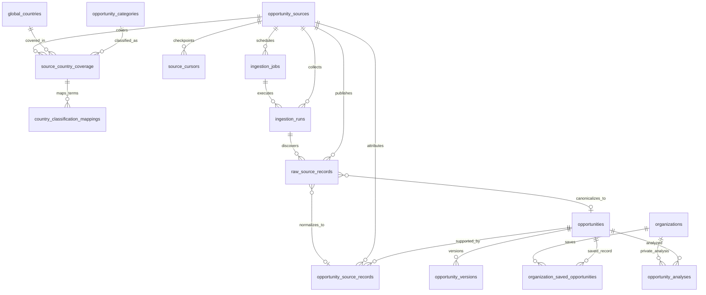

# OppSift ingestion database architecture

## Scope and status

This document describes migrations `0001` through `0006`. Migrations `0003`
through `0006` remain **pending** in
`backend/neon/migrations/migration-status.json`. None has been applied by
this work. Migrations `0003` and `0004` define durable persistence structures
and source-approval expiry. Migration `0005` adds the inactive, unreviewed
World Bank candidate. Migration `0006` adds inactive, unreviewed TED,
Contracts Finder, and SAM.gov candidates. Neither migration activates
collection.

The database has three related concerns:

1. Neon Auth and organization-owned data.
2. The global source registry and canonical opportunity model.
3. Collection control, run history, and source-payload provenance.

Global opportunity and source information is separate from organization
preferences, saved opportunities, and private analyses.

## Existing table inventory

### Identity and tenant tables (`0001`)

| Table | Responsibility and key relationships |
|---|---|
| `user_profiles` | User-facing profile linked to `neon_auth.user`; one profile per user. |
| `organizations` | Tenant/company record; created by an Auth user. |
| `organization_memberships` | User-to-organization membership and role; unique per pair. |
| `organization_settings` | Private organization settings JSON, one row per organization. |
| `organization_invitations` | Invitation status and recipient, linked to organization and inviter/accepting users. |
| `organization_invitation_tokens` | Hashed invitation token, one per invitation. |
| `audit_logs` | Organization-scoped audit events and optional actor. |

### Global intelligence tables (`0002`)

| Table | Responsibility and key relationships |
|---|---|
| `currencies`, `languages` | Global reference data. |
| `global_countries` | Country registry with region and coverage lifecycle. |
| `country_currencies`, `country_languages` | Country-to-currency/language associations. |
| `opportunity_categories`, `opportunity_types` | Canonical category and type taxonomies. |
| `opportunity_sources` | Source metadata, reliability, terms/license evidence, integration status, and health. Extended by `0003`; see below. |
| `source_country_coverage` | Source, country, category coverage state and verification evidence. |
| `country_classification_mappings` | Source terminology mapped to canonical category/type, linked to a source-country-coverage row. |
| `opportunities` | Canonical, global opportunity records; country/category/type references and searchable document. |
| `opportunity_source_records` | One source-specific record per `(source_id, external_record_id)` with source URLs and original field values. |
| `opportunity_versions` | Numbered canonical snapshots, optionally attributed to a source record. |
| `opportunity_duplicate_candidates` | Pairwise duplicate candidates and review outcome. |
| `ingestion_runs` | Per-source execution history and discovered/parsed/accepted/duplicate/failed/created/updated/rejected/review/retry counts. Extended by `0003`. |
| `ingestion_errors` | Error details for a run. |
| `ingestion_review_queue` | Parsed records and quality issues awaiting human review. |
| `opportunity_quality_issues` | Record/run-scoped validation or quality issues. |
| `organization_saved_opportunities` | Tenant-private saved canonical opportunities and private notes. |
| `opportunity_analyses` | Opportunity intelligence results, globally published or organization-private. |

## Tables and changes added by `0003` through `0006`

### Changes to existing tables

`opportunity_sources` gains:

- Official API/feed URL and connector identifier.
- License and terms URLs, reuse-permission state, retention restrictions,
  request/window rate limits, and next scheduled collection time.
- Coverage scope (`global`, `regional`, `country`, `multi_country`) and
  region codes. Exact country/category support continues to use
  `source_country_coverage`.
- Approval state (`unreviewed`, `approved`, `approved_with_constraints`,
  `denied`), documented constraints and an enforcement flag.
- Collection activation state (`inactive`, `active`, `paused`).
- Migration `0004` adds `approval_expires_at`; an expired approval is excluded
  from source listing, scheduling, claiming and execution.
- Migration `0005` seeds the World Bank Procurement Notices candidate only when
  neither its fixed candidate ID nor official source name is already present.
  The row is `unreviewed`, `inactive`, and `in_development`, with licensing
  and terms still `review_required` and reuse permission `unknown`.
- Migration `0006` seeds the TED, Contracts Finder, and SAM.gov API candidates
  by connector identifier or official source name. All three are
  `unreviewed`, `inactive`, and `in_development`, with licensing and terms
  `review_required` and reuse permission `unknown`. It adds no tables.

Approval is distinct from activation. An approved source is not thereby
collecting. Active collection requires an operational connector, explicit
approval, verified license/terms/permission evidence and permitted reuse.
Conditional approval additionally requires documented constraints and
`approval_constraints_enforced = true`. Restricted, unreviewed and denied
sources therefore cannot be active.

The approval checks intentionally require supporting evidence URLs and the
existing verified license, terms and reliability states. This is a conservative
gate; actual interpretation and enforcement of reuse terms remains an
operational responsibility and is not automated by this schema.

`ingestion_runs` gains parsed, accepted and failed counters, elapsed time in
milliseconds, and an optional link to its durable job.

`opportunity_source_records.opportunity_id` becomes nullable with
`ON DELETE SET NULL`. Deleting a canonical opportunity no longer deletes its
source attribution row; source records remain separately addressable.

### New tables

| Table | Primary key / uniqueness | Purpose |
|---|---|---|
| `source_cursors` | `(source_id, cursor_name)` | Incremental position, pagination token, last-seen external ID, ETag/Last-Modified, arbitrary JSON state, sync timestamp and optimistic cursor version. |
| `ingestion_jobs` | UUID; unique `(source_id, job_type, idempotency_key)` | Durable scheduling, priority, retries, lease/lock, error and lifecycle timestamps. States are `pending`, `running`, `succeeded`, `failed`, `dead_lettered`. |
| `raw_source_records` | UUID; unique `(source_id, external_record_id, payload_checksum)` | Retained raw payload versions, provenance, source URL, content type, seen timestamps, processing state and optional collection-run/canonical/source-record references. Composite foreign keys ensure linked runs/source records belong to the same source. Deletes are blocked, but updates are not otherwise prohibited by this schema. Payloads may be JSONB, text, or a Cloudflare R2 bucket/key reference. JSON/text storage is bounded to approximately 2 MB per field; larger objects belong in R2. |

### Relationships



The source registry, country coverage, and taxonomy relationships remain the
source of supported market/category metadata. A global source can declare
`coverage_scope = 'global'`; country-specific verified coverage remains
explicitly represented by `source_country_coverage`.

## Integrity, retention, and indexes

- Approval states, activation states, job states, attempt bounds, lease
  completeness, terminal completion timestamps, rate-limit pairs, regional
  coverage requirements, payload locations, R2 reference pairs, payload size,
  timestamps, HTTPS URLs and checksums are constrained in SQL.
- Source/job idempotency is enforced by the unique job key. Raw payload
  revisions are distinguished by checksum, without overwriting prior payloads.
- Jobs, raw records, cursors, runs, and raw-to-source/canonical relationships
  use restrictive foreign keys where removal would orphan collection history.
  Canonical deletion nulls its reference in source and raw records; it does not
  cascade-delete raw payload provenance.
- Delete triggers prevent deletion of ingestion runs, jobs, or raw source
  records. No automatic retention/archive job is implemented. A future,
  explicitly approved retention process must account for source terms and
  retention restrictions.
- Job indexes support pending-job scheduling, expired lease scans and source
  history. Run indexes support source/job timelines. Raw-record indexes
  support source/external-ID lookup, source-consistent run/source-record
  lookups and processing queues.
- Existing indexes continue to support source coverage, canonical search,
  duplicate review, ingestion errors, organization saves and analyses.

## Security boundaries

- Global, verified opportunities and reviewed source/coverage metadata use
  public read policies. The `0003` replacement policies require an approved
  source state in addition to the pre-existing verified license, terms and
  reliability checks. Public reads do not imply public writes.
- `0003` revokes public, `anon`, and `authenticated` access to the new cursor,
  job and raw-record tables and enables RLS without creating client policies.
  It also revokes public-facing writes to source administration and existing
  ingestion/quality tables.
- Organization records remain tenant-scoped through the existing membership
  checks and RLS policies. Private notes and organization-specific analyses
  do not become global opportunity fields.
- Migration `0003` itself does not provision a worker role. The separate
  `backend/neon/provisioning/ingestion-worker-permissions.sql` script defines
  a restricted `NOLOGIN`, `NOBYPASSRLS` privilege role with explicit
  ingestion-table grants and policies. It has only been exercised against
  isolated PGlite; it has not been applied to Neon. A separate LOGIN identity
  and secret must be provisioned through reviewed server-side administration,
  never committed or exposed to frontend code. The role has no organization
  table access and no delete privileges.
- The provisioning SQL grants the worker only column-level `UPDATE` access to
  `opportunity_sources.next_scheduled_collection_at`, with a dedicated RLS
  policy requiring a currently eligible, approved source and a future schedule.
  The worker cannot edit approval, license, activation, or other source data.
- The migration does not create source approvals, activate sources, seed
  connectors, or change any environment configuration.

## Lifecycle and future collector integration

### Source approval lifecycle

```text
unreviewed -> approved -> active
unreviewed -> approved_with_constraints -> active only after constraints are enforceable
unreviewed/approved -> denied (cannot be active)
active -> paused/inactive when collection must stop
```

The status checks prevent collection activation without approval evidence.
Approvers still need a separately governed workflow to inspect the official
terms, document evidence and record any conditions. This migration does not
implement that workflow or an approval history log.

### Job and run lifecycle

```text
pending -> running (worker lease required)
running -> succeeded | failed | dead_lettered (completion timestamp required)
```

The schema stores retry limits and an idempotency key. The repository and
orchestration code now implement bounded due-source scheduling, transactional
idempotent queueing and schedule advancement, prioritized lease claims,
expired-lease recovery, bounded retry/backoff, dead-lettering, and cursor
commit after successful ingestion. The separate Cloudflare Worker and its
five-minute trigger are source-configured but not deployed; Hyperdrive is a
placeholder and the connector profile map is empty. See
`docs/INGESTION_ORCHESTRATION_ARCHITECTURE.md`.

`NeonIngestionRepository` implements durable source lookup and approval gates,
run tracking, raw payload persistence/state updates, source-record and
canonical opportunity upserts/versioning, quality/review/error storage, job
enqueue/claim/lease/retry/dead-letter operations, and cursor compare-and-swap.
Expired leases are reclaimed transactionally, and cursor advancement can be
committed in the same transaction as successful job completion. The
`HyperdriveDatabaseExecutor` provides parameterized PostgreSQL access through
an injected Cloudflare Hyperdrive binding.

The existing `runIngestion` function now stores each raw payload before
normalization and records raw processing states. These primitives are tested
against the actual SQL migrations in isolated PGlite, but no production
collector, queue dispatcher, scheduled trigger, Hyperdrive binding or running
worker is configured. A parser/validator maps accepted data to
`opportunity_source_records` and canonical `opportunities`, with duplicates
and quality issues routed through existing review/deduplication structures.
`raw_source_records` preserves provenance if canonical records later change
or are removed.

### Integration points not yet implemented

1. Source-specific collectors/adapters use the registry's connector ID, access
   method, URL, rate limits, schedule, approval and retention rules.
2. A server-side scheduler/worker claims `ingestion_jobs` and maintains cursors.
3. Format parsers produce raw envelopes with checksums and collection-run IDs.
4. Normalization persists source records and canonical opportunities with
   idempotent upsert/merge behavior.
5. Quality, duplicate and review workflows process ambiguous records.
6. Monitoring updates source health and last-success/next-schedule metadata.
7. An explicit retention/archive process handles permitted payload retention
   and optional R2 object lifecycle.

The TypeScript contracts validate source metadata, cursor/job envelopes and raw
payload envelopes. The repository and executor now provide persistence, but
they do not implement collectors or start ingestion by themselves. No source
is operational merely because a registry row exists.

## Migration and validation

`0003_durable_ingestion_foundation.sql` depends on `0001` and `0002`;
`0004_ingestion_orchestration.sql` depends on `0003`;
`0005_world_bank_procurement_notices_source.sql` depends on `0004`;
`0006_api_client_source_candidates.sql` depends on `0005`. Migrations `0003`
through `0006` remain `pending` in the manual development ledger. The
migrations and worker SQL were executed by the automated integration suite
using isolated PGlite with mocked Neon Auth
dependencies. This verifies PostgreSQL-compatible DDL and repository behavior,
not Neon Auth, Cloudflare Hyperdrive, or a remote database. The migrations and
provisioning script have not been applied to development or production Neon.
