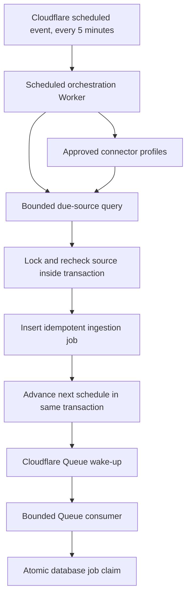
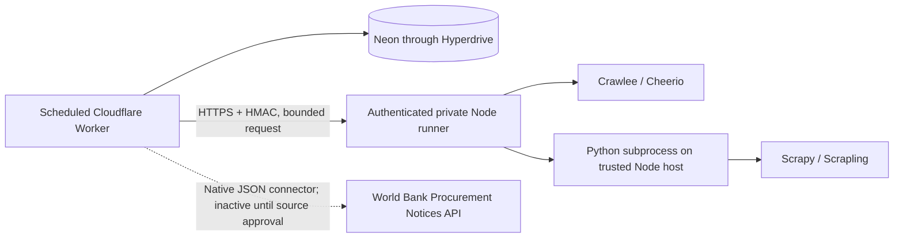

# Ingestion orchestration architecture

## Status boundary

The scheduler and dispatcher are implemented as repository code and have local
unit/integration coverage. The Worker configuration declares a Cloudflare
Queue producer/consumer so the Cron scheduler can persist jobs and hand off
dispatch asynchronously. The two Queue resources exist in the authenticated
Cloudflare account, but the Worker is not deployed or bound to them, and no
Hyperdrive resource is configured. Native World Bank, TED, Contracts Finder,
and SAM.gov API profiles are registered. Their candidate sources are
unreviewed and inactive; TED, Contracts Finder, and SAM.gov have no category
mappings and their records would be routed to review. No source is scheduled,
collected, activated, or verified operationally.

Migrations `0003` through `0006` remain pending. Do not mark them applied until
they have been reviewed and verified against the selected non-production Neon
branch. The local PGlite suite validates PostgreSQL behavior but does not
replace a Neon migration rehearsal.

## Scheduling flow

The due-source selection applies all source approval and activation gates,
requires a connector ID in the Worker profile map, respects
`expected_refresh_hours` and the configured global minimum interval, excludes
sources with pending/running jobs, and limits the batch. A source must be
approved, permitted for reuse, licensed, terms-verified, active, operational,
reliable, and unexpired. Conditional approvals are not schedulable because no
constraint evaluator is provided.

The repository repeats these checks under a source-row lock. Job insertion,
idempotency protection, and updating `next_scheduled_collection_at` occur in
one transaction. A duplicate idempotency key still advances the schedule after
the due-state recheck, preventing repeated scans of a permanently conflicting
slot. The ingestion worker receives only column-level `UPDATE` privilege for
`opportunity_sources.next_scheduled_collection_at`, constrained by a dedicated
RLS update policy; it cannot edit approvals or other registry fields.

Configuration in `backend/neon/worker/wrangler.toml` bounds source count,
minimum frequency, retries, jobs, and concurrency. Each Cron invocation
persists due jobs before sending a small Queue wake-up. The Queue consumer
dispatches by claiming durable database jobs; the Queue message is not a job
payload and duplicate deliveries are safe because database leases and job
idempotency remain authoritative. Failed dispatches retry and eventually go
to the configured dead-letter Queue. The deploy helper accepts a
deployment-time `HYPERDRIVE_ID`, substitutes it into a temporary Wrangler
config, and defaults to a dry run. Wrangler bindings cannot be selected by a
Worker runtime variable. Queue names in Wrangler config do not create the
remote Queues. The five-minute trigger is configuration, not evidence of
deployment.

## Dispatch, leases, and cursor safety

The dispatcher claims due jobs by priority through the repository's atomic
claim transaction. The claim locks both the selected job and source, skips
locked rows, filters unsupported connectors, and prevents another unexpired
running job for the same source. Expired leases are recovered; exhausted jobs
move to `dead_lettered`. Retry delay is bounded exponential backoff.

Each execution has bounded job count, concurrency, duration, request count,
response sizes, and lease duration. A heartbeat renews the lease and aborts
collection if lease renewal fails. The dispatcher reloads and revalidates the
source before creating its connector. It commits a cursor only after clean
ingestion and completes the job and cursor update transactionally. Failed or
review-incomplete runs do not advance the cursor. Every run and raw record
remains attached to the existing durable ingestion history.

## Runtime boundary

Cloudflare Workers do not spawn Python. The Worker transport sends signed,
timestamped, nonce-protected requests to the private Node runner; the runner
checks HMAC signatures in constant time, rejects replayed/stale requests,
bounds request/result sizes, concurrency and execution time, and returns
generic errors. The Node runner routes Crawlee/Cheerio locally and delegates
Scrapy/Scrapling to the existing Python subprocess adapter. It listens on
loopback by default for local development. A production runner must be
network-private, use HTTPS, receive secrets out of band, and have a reviewed
deployment/network policy; the shared HMAC key is not a substitute for network
isolation.

The Worker profile map contains the native World Bank JSON connector. The
candidate registry row remains unreviewed and inactive, so it is not eligible
for source scheduling. Native API profiles call only their fixed, approved
HTTPS host through the shared safe-fetch controls and do not require the
private Node runner. Collector-framework profiles continue to require the
authenticated runner and runner-side approval validation.

## Failure and security controls

- Approval, reuse, licensing, terms, evidence, reliability, activation, and
  expiry are checked when listing, scheduling, claiming, and executing.
- Source host restrictions and allowed HTTP methods are carried in the
  validated collector request; redirects and non-HTTPS destinations are
  rejected by the transport/runtime boundary.
- Native API connectors use the same approved-host validation, HTTPS-only
  requests, bounded response sizes, timeouts, retry policy, and per-run request
  budgets; they do not inherit undocumented source quotas.
- Request limits are clamped to source-specific limits and the configured
  collection interval.
- Lease tokens fence completion, retry, and cursor commits.
- Raw source records, ingestion runs, and jobs are retained according to the
  existing foreign-key and retention rules; the orchestrator does not delete
  history.
- Logs expose event categories only; exception details and credentials are
  redacted by existing repository/collector error handling.
- No production credentials, source activation, migration application, Worker
  deployment, or real-site test was performed. The two empty Queue resources
  were provisioned in the Cloudflare account that contains the existing Pages
  project; neither has a Worker producer or consumer until deployment.

## Local validation

Focused coverage is in:

- `backend/neon/intelligence/orchestration.test.ts`
- `backend/neon/intelligence/worker-collector-transport.test.ts`
- `backend/neon/intelligence/neon-ingestion-repository.integration.test.ts`
- `backend/neon/migrations/0003_durable_ingestion_foundation.integration.test.ts`
- `collectors/node/tests/`
- `collectors/python/tests/`

Validation performed for this implementation:

| Command | Result |
|---|---|
| `npm test -- --pool=threads --maxWorkers=1 --reporter=dot` | Passed: 37 files, 222 tests. |
| Worker Queue consumer tests | Passed: 3 deterministic tests for success, retry, and invalid-message handling. |
| Focused Vitest for repository, migrations, orchestration, and Worker transport | Passed: 4 files, 24 tests; after adding concurrent-scheduling assertions, the focused repository/migration check passed: 3 files, 19 tests. |
| `npm run typecheck` | Passed. |
| `npx tsc --project backend/neon/worker/tsconfig.json --pretty` | Passed. |
| `npm run build` | Passed. Vite reported existing dependency annotation and large-chunk warnings. |
| `npm run lint` | Passed with 7 warnings and 0 errors; warnings are in existing UI files. |
| `npm test --prefix collectors/node` | Passed: 14 tests. |
| `.\.venv\Scripts\python.exe -m unittest discover -s tests -v` from `collectors/python` | Passed: 10 tests. |
| `npx wrangler deploy --dry-run --config backend/neon/worker/wrangler.toml` | Passed bundle/config dry-run; the Hyperdrive ID remains a placeholder. No deployment occurred. |

These are local code and fixture checks, not production readiness evidence.
No live public websites, remote Neon branches, production credentials,
migrations, or deployed services were used.

## Deployment prerequisites

1. Review and apply migrations `0003` and `0004` only to an authorized,
   disposable Neon branch; validate the migration and provisioning SQL there.
2. Provision least-privilege worker database credentials out of band and
   configure a real Hyperdrive binding in the selected non-production
   environment.
3. Confirm the provisioned `oppsift-ingestion-dead-letter` and
   `oppsift-ingestion` Queues are in the intended production Cloudflare
   account. They are currently unbound until the Worker is deployed.
4. Review the World Bank connector's license scope, notice types, privacy,
   retention, source quota, and incremental strategy. Verify each source's
   terms, license, attribution, retention, rate limits, and permissions before
   any activation.
5. Deploy the private Node/Python runner to a restricted network environment,
   lock and review Python dependencies, configure HTTPS and secret storage, and
   verify HMAC operation and time synchronization.
6. Add operational observability, alerting, source health review, and
   retention/R2 lifecycle controls before scheduling real collection.
7. Rehearse end-to-end ingestion against a permitted test source and verify
   normalization, deduplication, cursor safety, tenant separation, and
   customer-display approval before production rollout.
